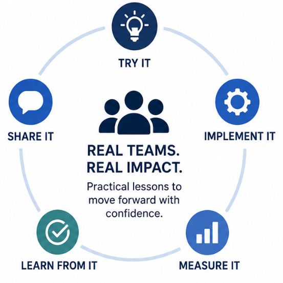

# Early Adopter Stories

    

        

        Early Adopter Stories highlight how real teams are using AI tools and practices across the software development lifecycle. These stories capture what they tried, how they implemented it, what they learned, and the impact it had.
        

        

        They turn insights into action. By sharing honest, practical experiences, we help teams learn from each other, avoid common pitfalls, and build confidence as they adopt AI responsibly and effectively.
        

    

    

        
    

<strong>Real experiences. Practical insights. Stronger outcomes.</strong>

These stories inspire smarter decisions and accelerate AI success across our community.

